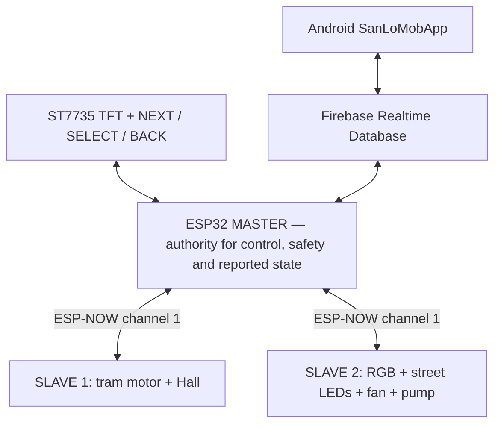

# RJ45 DIORAMA — System Context and Integration Architecture

> **Purpose:** Persistent project reference for Antigravity. Read before modifying the existing Android application or ESP32 firmware. This document describes agreed requirements and distinguishes tested behavior from intended behavior. It is **not** proof that the current code implements every requirement.

## 1. Project mission

The existing **SanLoMobApp** Android Studio application is an **unfinished draft**, not the approved interface. Redesign its UI/navigation as needed to accurately represent the physical **RJ45 Diorama**, but **reuse useful existing code**, remain in the cloned repository, and avoid changing functioning hardware logic unnecessarily.

The mobile app is an additional interface required for the academic exhibit, **not a replacement** for the ESP32 MASTER, TFT LCD, local buttons, sensors, or automatic simulation. The most important behavior is **two-way state synchronization**: local TFT/hardware changes appear in Android, and authorized Android requests are processed by MASTER and reflected on TFT and hardware.

## 2. Architecture and authority



- Firebase stores **requests** separately from **MASTER-reported state**, telemetry, acknowledgments, and logs. Firebase writes or ESP-NOW send callbacks **do not prove physical actuation**.
- MASTER validates commands, arbitrates local/app input, enforces safety, and publishes the confirmed or best-known state. TFT and Android render that same state.
- Preserve autonomous physical behavior if Wi-Fi/Firebase is unavailable. Do not let reconnect replay stale commands or override newer local changes.
- **Wi-Fi coexistence risk:** ESP-NOW currently uses channel **1**; infrastructure Wi-Fi must be channel-compatible or the network architecture must be adjusted deliberately. Do not silently alter working slave radio settings.
- Protect the local hardware from remote requests with authentication, database security rules, command expiry, unique IDs, deduplication, acknowledgment/timeouts, and safe startup behavior.

## 3. Hardware inventory and current evidence

### MASTER ESP32

- ST7735 TFT display, NEXT GPIO25, SELECT GPIO26, BACK GPIO13.
- PIR motion GPIO19; DHT11 GPIO4.
- Shared I²C SDA GPIO21 / SCL GPIO22: APDS9960 gesture sensor (INT GPIO33), TCS34725 color sensor, DS3231 RTC, PCF8591 ADC.
- PCF8591: water level sensor AIN0; flex sensor AIN2.
- DFPlayer Mini serial ESP32 RX GPIO16, TX GPIO17; one DFPlayer supports one audio track at a time.
- TFT: SCK GPIO18, MOSI GPIO14, RST GPIO32, DC GPIO27, CS GPIO5.
- Physical button/menu and ESP-NOW code already exist. **Inspect the latest actual firmware before changes.**

### SLAVE 1

- ESP32 MAC `D4:E9:F4:A3:50:A8`.
- Tram motor through L298N: GPIO16/17/18; Hall sensor GPIO13; servo gate GPIO4.
- Previously confirmed working MASTER ↔ SLAVE 1 tram system. **Do not modify SLAVE 1 without a demonstrated need.**
- Important latest requirement: **Tram — Gesture → Motor → Hall**. Earlier design included servo gate in the tram cycle; **do not assume that gate is now part of Tram simulation** without checking current wiring and confirming whether it has been reassigned.

### SLAVE 2

- ESP32 MAC `D4:E9:F4:E3:4E:2C`.
- 74 WS2812B RGB LEDs GPIO13; street LEDs GPIO25/26/27/32/33.
- Fan relay GPIO18 (active LOW); pump relay GPIO5 (active LOW).
- RGB and street LEDs worked in individual tests. **Fan and pump hardware behavior remain unverified**; avoid claiming they work.
- GPIO5 is a boot strapping pin; evaluate unexpected relay activation on boot. Use appropriate isolated/rated supplies and grounding; never run pump dry.

### Power stability

- Battery → buck converter around 5.0 V, but ~4.7 V observed at a slave board; user observed intermittent behavior when USB was not used. **Power delivery and voltage under load are not yet diagnosed**. Do not mask this with firmware changes or blindly increase buck voltage.

### Existing ESP-NOW packet

```cpp
struct CommandPacket { uint8_t command; int16_t value; }; // expected 4 bytes
// 0 STOP
// 1 TRAM_FORWARD, 2 TRAM_REVERSE, 3 TRAM_STOP
// 4 GATE_OPEN, 5 GATE_CLOSE
// 10 FANS_ON, 11 FANS_OFF
// 12 PUMP_ON, 13 PUMP_OFF
// 14 LIGHT_LEVEL
// 15 STRIP_ON, 16 STRIP_OFF, 17 STRIP_COLOR
```

Verify actual source before relying on numeric values or adding acknowledgments. The existing color command encoding must be inspected before assuming arbitrary RGB values are supported.

## 4. Approved physical simulation menu

```text
MAIN MENU
  Simulation
    Individual Simulation
      Tram
      Street Lights
      RGB Lighting
      Wind
      Drainage
    Full System Simulation
  Dashboard
  Recording
```

**Latest user-defined functional sequences (supersede earlier versions):**

1. **Tram:** Gesture → Motor → Hall.
2. **Street Lights:** DS3231 RTC **or virtual Demo Time** → LEDs.
3. **RGB Lighting:** TCS34725 **or manual color** (TFT/Android) → RGB strip.
4. **Wind:** **Fan → Flex sensor**. This is the latest requested ordering; verify the physical relationship and what flex feedback means before rewriting prior flex-triggered fan logic.
5. **Drainage:** Water level sensor → Pump → **Servo**. This is the latest requested sequence. **Servo placement, pin, board ownership and actual plumbing/mechanics are not yet verified.** Existing known servo is on SLAVE 1 (previously tram gate); do not assume it is the same servo or relocate it without confirmation.

Individual Simulation means **functional sensor/actuator operations**, not isolated manual ON/OFF component tests. Full System Simulation should coordinate all five without breaking local automatic logic. Show actual mode and state, not fabricated completion percentages.

## 5. RGB synchronization: physical TFT and Android

### Expected local TFT interaction

```text
SIMULATION
INDIVIDUAL
RGB LIGHTING
COLOR: < ORANGE >
```

- NEXT cycles forward; BACK cycles backward **while in color-edit mode**; SELECT confirms. Design a separate reliable exit gesture/menu step to avoid conflict with BACK navigation. Verify existing button behavior before implementation.
- Provide **Sensor Mode** (TCS34725 determines color) and **Manual Mode** (TFT or Android chooses color). Manual selection must not immediately be overwritten by sensor updates.
- Example: TFT selects ORANGE → MASTER updates shared RGB mode/color → sends to SLAVE 2 → Firebase state updates → Android displays ORANGE.
- Example: Android requests BLUE → Firebase command → MASTER validates → updates local state/TFT → sends SLAVE 2 → reports best-known outcome → Android reflects confirmed/requested status appropriately.
- Proposed palette: red, orange, yellow, green, blue, purple, white. Exact packet compatibility and display layout require source inspection.

## 6. Street lights: real RTC vs demonstration clock

- **Real RTC mode:** use actual DS3231 time for street-light schedule.
- **Demo Time mode:** user sets an **effective/virtual** hour/minute via Android (optionally TFT); MASTER uses it to evaluate the street-light schedule **without writing fake time to DS3231**.
- Quick presets such as Daytime / Nighttime are useful for exhibit. Allow Reset to Real RTC; label Demo Mode visibly on TFT and Android; use timeout/reboot fallback to real time.
- Previously discussed example schedule: **18:00–06:00**. **Verify this against latest firmware and beneficiary requirement before hardcoding.**
- Example 19:00 → LEDs ON, 10:00 → LEDs OFF if that schedule is confirmed. MASTER owns the effective mode/time and reported light state.

## 7. Android app: redesign the draft around the actual exhibit

Existing repository: `https://github.com/isZet-True/SanLoMobApp.git` (private).
Branch: `feature/rj45-firebase-integration` (do not work directly on `master`).
Package/application ID: `com.example.sanlomobapp`.
Firebase project ID: `sanlo-139ce`.
Realtime Database URL: `https://sanlo-139ce-default-rtdb.asia-southeast1.firebasedatabase.app`.
Firebase configuration: local `app/google-services.json`, must match package; avoid publishing config in public repos, and **never commit private keys/service-account credentials**.

The cloned project was reported to build after fixing `btnAskSan0Lo` → `btnAskSanLo` in `MainActivity.java`. Machine-specific JDK/Gradle paths should remain local. Actual current code and build state must be rechecked. Older app versions contain random simulated dashboard readings and may lack complete Firebase setup.

### Required primary navigation

1. **Dashboard** — real temperature, humidity, river level, visitor activity, tram/gate, RGB, street lights, fan, pump, connectivity, active simulation and alerts; no fake live values.
2. **Simulation** — Individual (five functional modes) and Full System; show current selected mode, status, event progression and warnings. Reflect TFT state.
3. **Controls** — request tram forward/reverse/stop, RGB manual color/sensor mode, RTC demo time, safe street-light override, fan/pump controls (subject to safety), and DFPlayer narration.
4. **Explore / AI** — PIR-based activity trends and interpretations, river alerts and environmental insights. **PIR does not identify people or count distinct visitors reliably.** AI must be an actual implemented model/service, not a fake label. Never expose private AI API keys in the app/firmware.
5. **Logs** — meaningful time-stamped sensor, visitor, simulation, control, alert and error events; avoid flooding Firebase with debug/FIFO messages.

Draft classes to inspect and reuse/refactor if present: `MainActivity`, `DashboardFragment`, `ControlsFragment`, `ExploreFragment`, `RgbLightFragment`, `LogsFragment`, `LogsAdapter`, `LogEntry`. **The draft UI is not authoritative**. Significant redesign is authorized; retain useful functional code, dependencies and navigation infrastructure.

### UI style

Modern nature-inspired IoT exhibit: forest green, earthy brown, cream, lively accents, clear state distinctions, readable cards and typography, restrained animations. Prioritize Simulation as a major first-class section, not hidden under Controls. Do not display "Connected" without valid heartbeat or "Completed" without evidence.

## 8. State and command model

Proposed schema, subject to audit:

```text
diorama/
  telemetry/sensors/...
  telemetry/visitor/...
  state/master/...
  state/slave1/...
  state/slave2/...
  state/simulation/...
  state/rgb/{mode,color,source,version,updatedAt}
  state/clock/{mode,realTime,demoTime,effectiveTime,updatedAt}
  commands/requests/{commandId}/...
  commands/results/{commandId}/...
  events/system/...
  events/visitor/...
  alerts/river/...
  voice/playback/...
```

- Commands: unique ID, source, target, action, arguments, issued timestamp, expiry, status. Enforce safe access via Firebase Authentication and least-privilege Realtime Database Rules.
- Results: pending, accepted/rejected, executing, acknowledged, timed out, failed. Reserve **physically completed** for actual evidence; existing slaves may not return such feedback.
- MASTER publishes state changes and periodic heartbeat/telemetry with sensible throttling. App handles null/loading/error/stale/offline states.
- Local safety overrides app requests. Pump cannot be forced OFF during critical high water. Overrides are temporary and expire safely.
- Never directly control slaves from the Android app; no bypass of MASTER.

## 9. Implementation order

1. Audit actual cloned Android repo and latest MASTER/SLAVE firmware. Report mismatches and missing physical details (especially Wind sequence and Drainage servo).
2. Protect Git: work on feature branch, keep original `master` intact; no unapproved push/merge; check existing compile fix and Gradle JDK settings.
3. Redesign Android navigation/UI around five screens. Preserve useful code, not incorrect draft screen behavior.
4. Configure Firebase Authentication, Realtime Database listeners, security rules and state models; build Android and display `--` when no real data exists.
5. Add MASTER Wi-Fi/Firebase telemetry without breaking ESP-NOW channel 1 or local behavior. Hardware test before remote commands.
6. Implement shared authoritative state and request/acknowledgment flow.
7. Implement RGB Sensor/Manual mode and TFT/Android bidirectional selection.
8. Implement virtual RTC demo time without changing DS3231.
9. Add remaining guarded controls, simulations, AI visitor analysis, narration, river alerts and logs.
10. Test real hardware, power supply stability, reconnect behavior, startup safety, Wi-Fi/ESP-NOW coexistence, and all five functions.

## 10. Unfinished-work / validation checklist

- [ ] Fan relay and Fan → Flex behavior validated.
- [ ] Water sensor → Pump → Servo behavior, ownership and hardware wiring validated.
- [ ] New Individual Simulation modes and BACK/NEXT/SELECT navigation tested.
- [ ] Full System Simulation end-to-end tested.
- [ ] RTC automatic street lights tested with actual time.
- [ ] TCS34725 → MASTER → SLAVE 2 RGB full chain tested.
- [ ] Tram Gesture → Motor → Hall complete cycle verified (and Hall feedback visibility clarified).
- [ ] DFPlayer track/voice-guide interaction verified.
- [ ] Dashboard and Recording actual data verified.
- [ ] Flex/water/color/gesture thresholds calibrated; restart, battery/buck voltage and ESP-NOW stability verified.

## 11. Instructions for Antigravity

**Read this file first**, then inspect actual source. Do not mistake proposed features for existing implementations or treat old screenshots/source as current without verification. Start with an audit and a file-by-file plan. You may redesign the draft app substantially, but protect Git history and working hardware code. Report every modification, build outcome and test limitation. Do not push/merge, operate untested actuators, or change GPIO/pin mappings without approval. **Ask the user to confirm the Wind Fan → Flex relationship and Drainage Pump → Servo hardware assignment before implementing those hardware-specific behaviors.**
